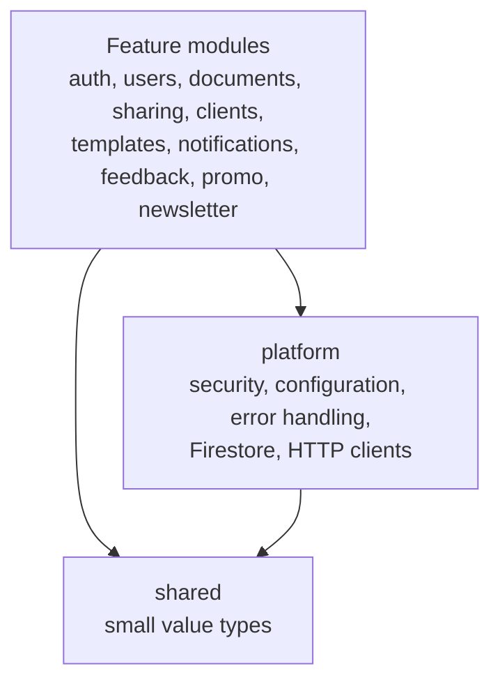
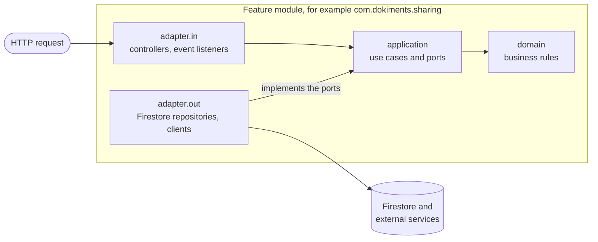

# Architecture

The code is a modular monolith: one application, split into modules with strict boundaries. Inside each feature
module, the code follows the hexagonal (ports and adapters) style. Both are checked on every build.

The full set of rules, including naming, errors, Firestore and security conventions, is in
[the agent instructions](../.github/copilot-instructions.md). It is written for AI coding agents and is just as useful
as a reference for developers.

## Modules

Each direct sub-package of `com.dokiments` is a module:

- **Feature modules:** `auth`, `users`, `documents`, `sharing`, `clients`, `templates`, `notifications`, `feedback`,
  `promo`, `newsletter`.
- **`shared`:** small value types used by every module.
- **`platform`:** technical setup such as security, configuration, error handling, Firestore and HTTP clients. It
  never depends on a feature module.

Modules only use each other's public API: a module's base package, a named interface, or application events. Its
sub-packages are internal. There are no cycles between modules.

## Inside a feature module

Dependencies point inwards, so the business rules in `domain` don't depend on Spring, Firestore or HTTP, and can be
tested without a framework:

| Package | Contains |
| --- | --- |
| `domain` | Pure Java models, business rules, domain events and exceptions |
| `application.port.in` | Use cases (interfaces) and their commands |
| `application.port.out` | What the use cases need from outside, such as repositories and senders |
| `application.service` | The use case implementations |
| `adapter.in` | Web controllers and their DTOs, event listeners |
| `adapter.out` | Firestore repositories and entities, clients for external services |

Web DTOs (the API contract), domain models (the rules) and Firestore entities (the stored shape) are kept apart, with
mapping between them. Side effects such as sending email happen in listeners reacting to domain events.

## How it is enforced

- `HexagonalArchitectureTest` (ArchUnit): layer dependencies, which libraries each layer may use (HTTP clients only in
  `adapter.out`), and no Lombok.
- `ModularityTest` (Spring Modulith): module boundaries and no cycles. It also writes module diagrams to
  `build/spring-modulith-docs/`.

Both run in `./gradlew test`. A new module needs a `package-info.java` with `@NullMarked` and
`@ApplicationModule(displayName = "...")`, and must be added to `FEATURE_MODULES` in `HexagonalArchitectureTest`.

## The API contract

The web app is a separate Next.js project that forwards `/api/*` requests to this service. Its paths, request and
response bodies, status codes and the `{ "error": "..." }` error shape are fixed: changing any of them breaks the UI.
See [Errors](configuration.md#errors) for the error responses.
