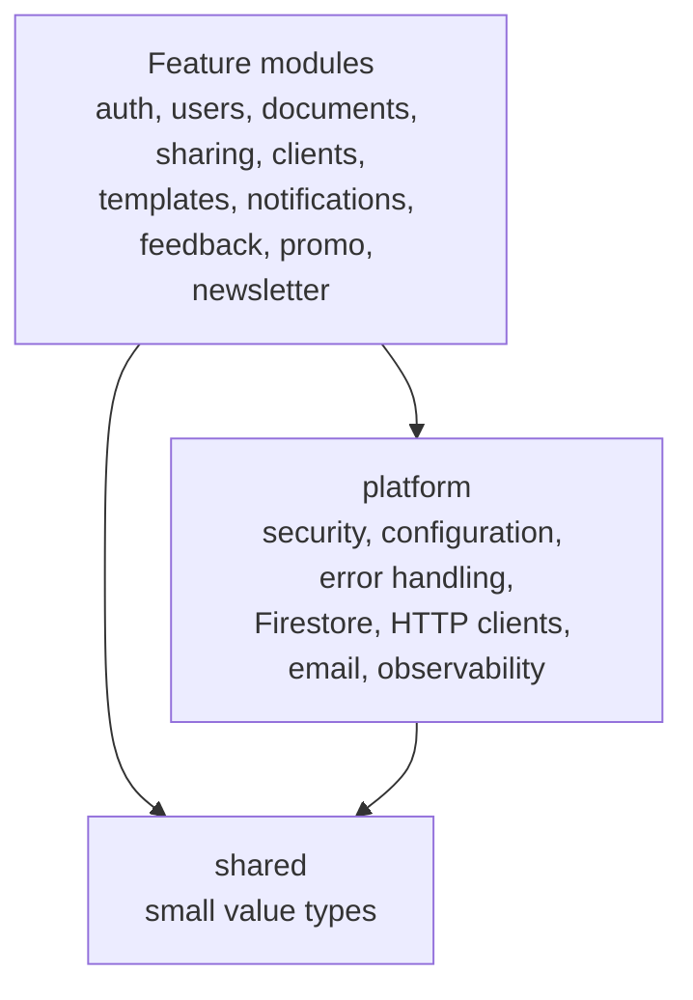

# Architecture

The code is a modular monolith: one application, split into modules with strict boundaries. Inside each feature
module, the code follows the hexagonal (ports and adapters) style. Both are checked on every build.

The full set of rules, including naming, errors, Firestore and security conventions, is in
[the agent instructions](../.github/copilot-instructions.md). It is written for AI coding agents and is just as useful
as a reference for developers.

## Modules

Each direct sub-package of `com.dokiments` is a module:

- **Feature modules:** `auth`, `users`, `documents`, `sharing`, `clients`, `templates`, `notifications`, `feedback`,
  `promo`, `newsletter`.
- **`shared`:** small value types used by every module.
- **`platform`:** technical setup such as security, configuration, error handling, Firestore, HTTP clients, email
  and observability. It never depends on a feature module.

Modules only use each other's public API: a module's base package, a named interface, or application events. Its
sub-packages are internal. There are no cycles between modules.

## Inside a feature module

Dependencies point inwards, so the business rules in `domain` don't depend on Spring, Firestore or HTTP, and can be
tested without a framework:

| Package | Contains |
| --- | --- |
| `domain` | Pure Java models, business rules, domain events and exceptions |
| `application.port.in` | Use cases (interfaces) and their commands |
| `application.port.out` | What the use cases need from outside, such as repositories and senders |
| `application.service` | The use case implementations |
| `adapter.in` | Web controllers and their DTOs, event listeners |
| `adapter.out` | Firestore repositories and entities, clients for external services |

Web DTOs (the API contract), domain models (the rules) and Firestore entities (the stored shape) are kept apart, with
mapping between them. Side effects such as sending email happen in listeners reacting to domain events.

## Building a feature module

The `newsletter` module is the reference: copy its layout and naming for a new module. For `POST /api/newsletter`:

| Layer | Class | Role |
| --- | --- | --- |
| `domain` | `SubscriberEmail`, `Subscriber`, `InvalidSubscriberEmailException` | The rules (what counts as an address, how it is cleaned) as records, without frameworks. A rule that fails throws a type extending one of `shared.error`. |
| `application.port.in` | `SubscribeToNewsletter` with its `SubscribeCommand` | The use case: an interface named after what it does, with its input as a nested record. |
| `application.port.out` | `NewsletterSubscribers` | What the use case needs, named after what it holds, not after Firestore. |
| `application.service` | `NewsletterService` | Implements the use cases. Package-private and annotated `@Service`; takes a `Clock` rather than calling `Instant.now()`. |
| `adapter.in.web` | `NewsletterController` with `SubscribeRequest` and `SubscribeResponse` | The endpoint. Package-private; the request and response records are the API contract, nested in the controller. `@Tag`, `@Operation` and `@Schema` describe it in `docs/openapi.yaml`. |
| `adapter.out.firestore` | `FirestoreNewsletterSubscribers`, `NewsletterDocument` | Implements the outbound port with Firestore. The document record is the stored shape, mapped from the domain model. |

Validation is split by what it protects:

- The request record checks the **shape** with Bean Validation (`@NotNull`, sizes), so a malformed body is answered
  before any code runs.
- The domain checks the **rules** (a plausible address, a document that may still change), so they hold however the
  use case is called.

Each layer gets its own tests:

- domain rules as plain unit tests (`SubscriberEmailTest`);
- the use case with an in-memory fake of its outbound port and a fixed clock (`NewsletterServiceTest`);
- the endpoint end to end, through the real security setup into the Firestore emulator (`NewsletterIT`): status
  codes, exact response bodies, and the stored document.

An endpoint stays closed (`401`) until it is opened in `platform/security/SecurityConfig`. A public endpoint that
uses no session is also exempted from CSRF there, because the web app sends no CSRF token.

### A signed-in user's own data

The `clients` module is the reference for endpoints that work on the signed-in user's own data:

- The controller gets the signed-in user from `@AuthenticationPrincipal SignedInUser user`. `SignedInUser` (in
  `shared`) carries only the user's ID; the session and its tokens stay inside `auth`.
- Every use case and port takes that ID, and the Firestore adapter builds every path from it
  (`users/{uid}/clients/{clientId}`). A client of someone else is then simply not there, and answers `404` exactly
  like one that doesn't exist.
- An ID from the URL is checked before it reaches Firestore (`ClientId.parse`): one that no document could have is
  treated as not found.
- A change reads the document first, then writes only the fields sent with `update()`, which never creates a
  document. Two changes to different fields at once both stay.
- Older documents are read leniently, with a missing field read as empty, while everything written follows the rules.
- When an answer depends on the user's plan, the use case asks `users.UserProfiles.roleOf(uid)`. That reads the role
  as stored now, so an upgrade counts straight away rather than at the next sign-in (`templates` does this).
- A rule that must hold across several documents, such as a free account's limit of saved templates, is checked and
  written in one Firestore transaction, so two requests at the same moment can't both get past it.

## How it is enforced

- `HexagonalArchitectureTest` (ArchUnit): layer dependencies, which libraries each layer may use (HTTP clients only in
  `adapter.out`), and no Lombok.
- `ModularityTest` (Spring Modulith): module boundaries and no cycles. It also writes module diagrams to
  `build/spring-modulith-docs/`.

Both run in `./gradlew test`. A new module needs a `package-info.java` with `@NullMarked` and
`@ApplicationModule(displayName = "...")`, and must be added to `FEATURE_MODULES` in `HexagonalArchitectureTest`.

## The API contract

The web app is a separate Next.js project that forwards `/api/*` requests to this service. Its paths, request and
response bodies, status codes and the `{ "error": "..." }` error shape are fixed: changing any of them breaks the UI.
See [Errors](configuration.md#errors) for the error responses.
