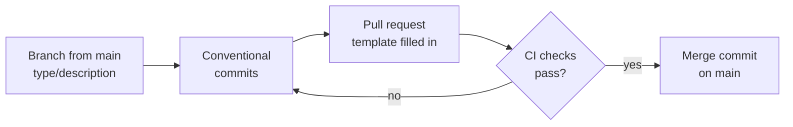

# Contributing

How changes get from a branch to `main`, and how versions are made.

## Workflow

- `main` is the only long-lived branch and is always deployable. Work on a short-lived branch named
  `<type>/<short-description>`, such as `feat/newsletter-subscribe`, and open a pull request.
- Pull requests are merged with a merge commit, so **every commit** lands on `main` and must follow
  [Conventional Commits](https://www.conventionalcommits.org/): `<type>(<scope>): <description>`, imperative and lower
  case, for example `feat(newsletter): add subscribe endpoint`. The pull request title follows the same format and
  becomes the merge commit's title. CI checks both.
- Types: `feat`, `fix`, `perf`, `refactor`, `test`, `docs`, `build`, `ci`, `chore`, `style`, `revert`. Scopes: a module
  name (`auth`, `sharing`, ...) or `platform`, `architecture`, `build`, `ci`, `docker`, `deps`. Mark breaking changes
  with `!`, as in `feat(sharing)!: ...`.
- The pull request template asks for a summary, how the change was tested, and its impact on the API contract,
  Firestore data, configuration and security. Those are the areas where a change can break the web app or a
  deployment.
- Clean up commits before merging, for example with `git commit --fixup <sha>` and
  `git rebase -i --autosquash main`. CI rejects `fixup!` and `squash!` commits.



## Before opening a pull request

```bash
./gradlew spotlessApply
./gradlew build
```

Then check the editor's Problems view, or run `scripts/inspect.sh` where IntelliJ IDEA is installed. See
[Testing and quality](testing-and-quality.md).

If the change adds or changes a command, convention or setting, update the matching guide in `docs/` and
`.github/copilot-instructions.md`.

## Working with AI agents

`.github/copilot-instructions.md` is the single source of instructions for AI coding agents: GitHub Copilot reads it
directly, and `CLAUDE.md` imports it for Claude Code. Edit that file, not a copy. Agents follow the same build and
inspection steps as developers before calling a change done.

## Versioning and releases

Versions follow [SemVer](https://semver.org/) and come from Git tags: tagging a commit `v1.4.0` makes it version
`1.4.0`. No version number is stored in the build files. Untagged builds get a version such as `1.4.0-5-gabc1234`, or
`0.0.0-SNAPSHOT` before the first tag. The running version is shown by `/actuator/info`.
