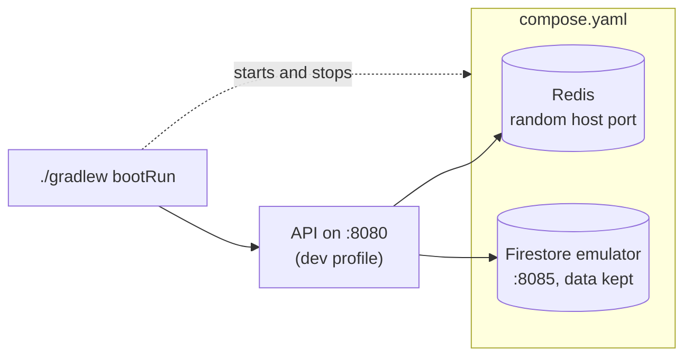

# Local development

How to run the API on your machine, what it starts, and how local data is kept. If you haven't set up the project yet,
start with [Getting started](getting-started.md).

## Running the application

```bash
./gradlew bootRun
```

This starts the application with the `dev` profile. Through Spring Boot's Docker Compose support it also starts Redis
and the Firestore emulator from `compose.yaml`, connects to them, and stops them again when the application stops.
The `dev` profile shows the Spring banner, readable coloured logs and full health details.



Check that it is up:

```bash
curl localhost:8080/actuator/health
```

If port 8080 is already in use on your machine, set `PORT=8081` (or any free port) in `.env`. See
[Local settings](configuration.md#local-settings).

### Automatic restarts

Spring Boot DevTools restarts the application whenever compiled classes change. IntelliJ IDEA compiles where
`bootRun` looks when you build the project; from a terminal or VS Code, run this in a second window:

```bash
./gradlew classes --continuous
```

See [IDE setup](ide-setup.md) for each editor.

### Keeping the services running

To keep Redis and the emulator running between application restarts, start them yourself:

```bash
docker compose up -d
```

The application then uses them and leaves them running when it stops. Stop them with `docker compose down`.

## Viewing traces

Every local request is traced. To see the traces, start Jaeger, a trace viewer, from `compose.yaml` and run the
application with the address it receives traces on:

```bash
docker compose --profile tracing up -d
OTEL_EXPORTER_OTLP_ENDPOINT=http://localhost:4318 ./gradlew bootRun
```

Then open [localhost:16686](http://localhost:16686) and pick `dokiments-api`. Each request shows its steps: security
checks, Firestore calls, Redis commands and calls to external services, with how long each took. The `X-Trace-Id`
header of a response is the ID to search for. Jaeger keeps traces in memory only; stop it with
`docker compose --profile tracing stop`.

`JAEGER_UI_PORT` and `OTLP_PORT` in `.env` change its ports. The variable has to be set on the command line as above,
because Spring Boot reads OpenTelemetry settings only from real environment variables.

## Local data

The Firestore emulator is the local database: nothing is read from or written to Cloud Firestore. The application
checks this at start-up: in the `dev` profile it only runs against the emulator, with the `demo-dokiments` project.

Its data **is kept between restarts**, including stopping `bootRun`, `docker compose down` and restarting your
computer. The emulator itself only holds data in memory, so `docker/firestore-emulator/start.sh` saves it to a Docker
volume: once a minute while it runs (`FIRESTORE_SAVE_INTERVAL_SECONDS`), and once more when it stops. On start, it
loads the latest save.

| You want to | Do this |
| --- | --- |
| Keep your data | Nothing: it is kept automatically |
| Start again with an empty database | `docker compose down --volumes` |
| See the saves | `docker compose exec firestore ls /data/exports` |

If the emulator is stopped abruptly (Docker force-quit, a crash, power loss), changes since the last save can be lost:
at most a minute with the default interval. Integration tests never use this data: they run against a fresh emulator
of their own.

## Running the API as a container

To run the API itself as a Docker container, the way it runs when deployed:

```bash
docker compose --profile full up --build
```

The container uses the `prod` profile, so logs are JSON. It talks to the Compose emulator, never to a real Firestore.
`API_PORT` in `.env` changes the host port (default 8080).

| Command | Starts |
| --- | --- |
| `docker compose up` | Redis and the Firestore emulator |
| `docker compose --profile full up --build` | Redis, the emulator and the API container |
| `docker compose --profile tracing up -d` | Jaeger, for viewing traces (see [Viewing traces](#viewing-traces)) |
| `./gradlew bootRun` | Redis and the emulator (automatically), and the API from your code |

## Docker image

```bash
docker build -t dokiments-api .
```

The image runs as a non-root user with the `prod` profile and sizes the JVM heap from the container's memory limit.
The jar is split into layers, so a code change only rebuilds the small application layer.

On a network with a TLS-inspecting proxy, the build can't download dependencies until it trusts the proxy's root
certificate. Pass it as a build secret; it is only used during the build and isn't stored in the image:

```bash
docker build -t dokiments-api --secret id=extra_ca,src=/path/to/proxy-root-ca.pem .
```

With Docker Compose, pass the certificate's contents instead:

```bash
EXTRA_CA_PEM="$(cat /path/to/proxy-root-ca.pem)" docker compose --profile full up --build
```
