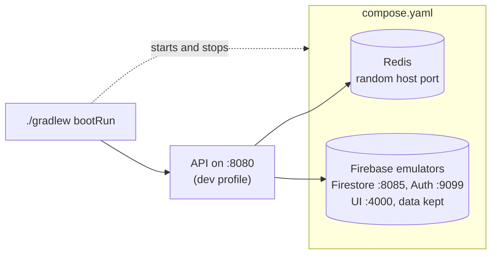

# Local development

How to run the API on your machine, what it starts, and how local data is kept. If you haven't set up the project yet,
start with [Getting started](getting-started.md).

## Running the application

```bash
./gradlew bootRun
```

This starts the application with the `dev` profile. Through Spring Boot's Docker Compose support it also starts Redis
and the Firebase emulators (Auth and Firestore) from `compose.yaml`, connects to them, and stops them again when the
application stops. The first run builds the emulators' image from `docker/firebase-emulators`, which takes a minute or
two; later runs reuse it.
The `dev` profile shows the Spring banner, readable coloured logs and full health details.



Check that it is up:

```bash
curl localhost:8080/actuator/health
```

If port 8080 is already in use on your machine, set `PORT=8081` (or any free port) in `.env`. See
[Local settings](configuration.md#local-settings).

### Automatic restarts

Spring Boot DevTools restarts the application whenever compiled classes change. IntelliJ IDEA compiles where
`bootRun` looks when you build the project; from a terminal or VS Code, run this in a second window:

```bash
./gradlew classes --continuous
```

See [IDE setup](ide-setup.md) for each editor.

### Keeping the services running

To keep Redis and the emulator running between application restarts, start them yourself:

```bash
docker compose up -d
```

The application then uses them and leaves them running when it stops. Stop them with `docker compose down`.

## Trying requests

With the application running, call it with `curl`, Postman or any HTTP client. It listens on port 8080, or `PORT` from
`.env`. For example, the public newsletter sign-up:

```bash
curl -i -X POST localhost:8080/api/newsletter -H 'Content-Type: application/json' -d '{"email":"you@example.com"}'
```

It answers `200` with `{"status":"subscribed"}`. Every response also has an `X-Trace-Id` header, the ID to search for
in the logs and in [Jaeger](#viewing-traces). Error responses use the bodies listed in
[Errors](configuration.md#errors), for example `400 {"error":"Invalid request body."}` for `{"email":"nope"}`.

**Swagger UI** lists every endpoint with its request and response bodies and its errors, and can send requests:
open [localhost:8080/swagger-ui.html](http://localhost:8080/swagger-ui.html) (or your `PORT`) while `bootRun` is
running, pick an endpoint and choose **Try it out**. The description behind it is at `/v3/api-docs` (JSON) and
`/v3/api-docs.yaml`. Both exist only in the `dev` profile: deployed, those addresses answer `401` like any other closed
path. Postman can import the description too (**Import**, then the `/v3/api-docs` address or `docs/openapi.yaml`).

In Postman, choose the method, enter the address, and for a body pick **raw** and **JSON**: Postman then sets
`Content-Type: application/json` itself.

The web app's repository has a Postman collection of every endpoint (`docs/postman-collection.json`) with a `baseUrl`
variable. Point `baseUrl` at `http://localhost:3000` for the web app's own API or at `http://localhost:8080` for this
one, to compare the two answers to the same request. They use different data: the web app its configured Firebase
project, this API the local emulator.

Endpoints that aren't built yet answer `401`. To see what a request stored, read the emulator directly, as in
[Looking at the data](#looking-at-the-data).

## Viewing traces

Every local request is traced. To see the traces, start Jaeger, a trace viewer, from `compose.yaml` and run the
application with the address it receives traces on:

```bash
docker compose --profile tracing up -d
OTEL_EXPORTER_OTLP_ENDPOINT=http://localhost:4318 ./gradlew bootRun
```

Then open [localhost:16686](http://localhost:16686) and pick `dokiments-api`. Each request shows its steps: security
checks, Firestore calls, Redis commands and calls to external services, with how long each took. The `X-Trace-Id`
header of a response is the ID to search for. Jaeger keeps traces in memory only; stop it with
`docker compose --profile tracing stop`.

`JAEGER_UI_PORT` and `OTLP_PORT` in `.env` change its ports. The variable has to be set on the command line as above,
because Spring Boot reads OpenTelemetry settings only from real environment variables.

## Local data

The Firebase emulators are the local Firebase: the Firestore emulator is the database, and the Auth emulator holds
the accounts people sign up with. Nothing is read from or written to a real Firebase project. The application checks
this at start-up: in the `dev` profile it only runs against the emulator, with the `demo-dokiments` project.

### How it is kept

Data **is kept between restarts**, including stopping `bootRun`, `docker compose down` and restarting your computer.
The emulators only hold data in memory, so `docker/firebase-emulators/start.sh` saves the Firestore data and the Auth
accounts to a Docker volume: once a minute while they run (`FIRESTORE_SAVE_INTERVAL_SECONDS`), and once more when
they stop. On start, it loads the latest save.

How the containers start and stop depends on how you run things:

- **`./gradlew bootRun` alone:** Spring Boot runs `docker compose up` when the application starts, and
  `docker compose stop` when it stops normally (`Ctrl+C`). The emulator saves on the way down, and the containers
  are stopped, not removed. The next `bootRun` starts them again.
- **`docker compose up -d` first, then `bootRun`:** the application uses the running containers and leaves them
  running when it stops. Stop them yourself with `docker compose down`, which also saves.

If the application is killed rather than stopped (an IDE's force stop, a killed Gradle process), Spring Boot can't
stop the containers. They keep running with your data, and the next `bootRun` reuses them.

| You want to | Do this |
| --- | --- |
| Keep your data | Nothing: it is kept automatically |
| Start again with an empty database | `docker compose down --volumes` |
| See the saves | `docker compose exec firebase ls /data/exports` (the newest `FIRESTORE_KEEP_SAVES` are kept) |
| See what the emulators did | `docker compose logs firebase` |

If the emulator is stopped abruptly (Docker force-quit, a crash, power loss), changes since the last save can be lost:
at most a minute with the default interval. Integration tests never use this data: they run against fresh emulators
of their own.

### Checking that data survives

1. Run `docker compose up -d`, then `./gradlew bootRun`, and write something, for example with the newsletter
   request in [Trying requests](#trying-requests).
2. In a second terminal, follow the emulators' log: `docker compose logs -f firebase`.
3. Stop the application (`Ctrl+C`), then run `docker compose down`. The log shows
   `[firebase-emulators] Stopping: saving the data first` and then `Saved and stopped`.
4. Run `docker compose up -d`. `docker compose logs firebase` now shows `Loading saved data from /data/exports/...`
   and `Ready: auth,firestore,ui`.
5. Read the data back (see [Looking at the data](#looking-at-the-data)): it is all there.

To see the limits: write something and immediately run `docker compose kill firebase`, which stops it without a
save. After `docker compose up -d`, that last change is gone, while anything older than the save interval is still
there. `docker compose down --volumes` instead deletes every save, and the next start reports
`No saved data yet, starting with an empty database`.

### Looking at the data

The **Emulator UI** at [localhost:4000](http://localhost:4000) (`EMULATOR_UI_PORT`) shows the local data while the
emulators run (`bootRun`, or `docker compose up -d`): **Firestore** to browse, edit and delete documents, with live
updates, and **Authentication** to see, add and remove accounts. It also lists the requests each emulator received.

The Firestore emulator also answers Firestore's REST API without any authentication, so `curl`, Postman or a browser
can read and change the local data directly. Every address starts with:

```text
http://localhost:8085/v1/projects/demo-dokiments/databases/(default)/documents
```

`8085` is the default `FIRESTORE_EMULATOR_PORT`. In Postman, save that address as a variable, for example `fs`, so
that `{{fs}}/newsletter` lists the newsletter collection.

| To | Request |
| --- | --- |
| List the collections | `POST {{fs}}:listCollectionIds` with the JSON body `{}` and the header `Authorization: Bearer owner` |
| List the documents in a collection | `GET {{fs}}/newsletter` |
| Read one document | `GET {{fs}}/newsletter/<document ID>` (the last part of a document's `name`) |
| Find documents by a field | `POST {{fs}}:runQuery` with a query, as below |
| Delete one document | `DELETE {{fs}}/newsletter/<document ID>` |
| Empty the whole local database | `DELETE http://localhost:8085/emulator/v1/projects/demo-dokiments/databases/(default)/documents` |

Listing collections is an administrator operation: `Bearer owner` is the emulator's built-in administrator token,
which only the emulator accepts. The last row is an emulator-only address, so it can't reach a real project either.

A query for the subscription with a given address:

```json
{
  "structuredQuery": {
    "from": [{ "collectionId": "newsletter" }],
    "where": {
      "fieldFilter": {
        "field": { "fieldPath": "email" },
        "op": "EQUAL",
        "value": { "stringValue": "you@example.com" }
      }
    }
  }
}
```

A query answers with a list of matches; when nothing matches, the list holds only a `readTime`.

In the answers, every value is wrapped in its type, such as `"email": { "stringValue": "you@example.com" }` or
`"createdAt": { "timestampValue": "2026-11-10T16:58:31.417090Z" }`. Long lists come in pages: when an answer has a
`nextPageToken`, add `?pageToken=<token>` for the next page.

From a terminal, this lists a collection with the values unwrapped:

```bash
curl -s "localhost:8085/v1/projects/demo-dokiments/databases/(default)/documents/newsletter" | python3 -c "import json,sys; [print(d['name'].rsplit('/',1)[1][:12], {k:list(v.values())[0] for k,v in d['fields'].items()}) for d in json.load(sys.stdin).get('documents',[])]"
```

## Running the API as a container

To run the API itself as a Docker container, the way it runs when deployed:

```bash
docker compose --profile full up --build
```

The container uses the `prod` profile, so logs are JSON. It talks to the Compose emulator, never to a real Firestore.
`API_PORT` in `.env` changes the host port (default 8080).

| Command | Starts |
| --- | --- |
| `docker compose up` | Redis and the Firebase emulators |
| `docker compose --profile full up --build` | Redis, the emulator and the API container |
| `docker compose --profile tracing up -d` | Jaeger, for viewing traces (see [Viewing traces](#viewing-traces)) |
| `./gradlew bootRun` | Redis and the emulator (automatically), and the API from your code |

## Docker image

```bash
docker build -t dokiments-api .
```

The image runs as a non-root user with the `prod` profile and sizes the JVM heap from the container's memory limit.
The jar is split into layers, so a code change only rebuilds the small application layer.

On a network with a TLS-inspecting proxy, the build can't download dependencies until it trusts the proxy's root
certificate. Pass it as a build secret; it is only used during the build and isn't stored in the image:

```bash
docker build -t dokiments-api --secret id=extra_ca,src=/path/to/proxy-root-ca.pem .
```

With Docker Compose, pass the certificate's contents instead:

```bash
EXTRA_CA_PEM="$(cat /path/to/proxy-root-ca.pem)" docker compose --profile full up --build
```
