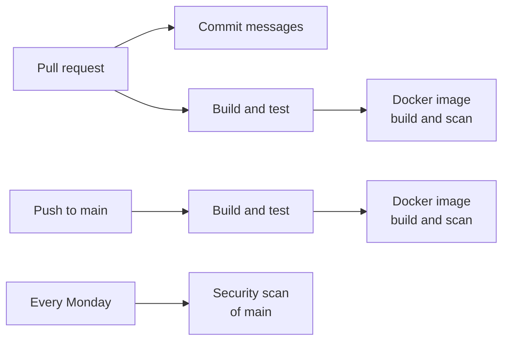

# Testing and quality

The build is strict on purpose, so problems are fixed while the code is written rather than found in review. This
guide covers the tests, the checks the build runs, IntelliJ's extra inspections, and CI.

## Tests

| Command | What runs | Needs Docker |
| --- | --- | --- |
| `./gradlew test` | Unit and architecture tests | No |
| `./gradlew integrationTest` | Integration tests against real Redis and Firebase emulator containers | Yes |
| `./gradlew build` | Formatting check, compile checks, both test suites and coverage | Yes |

Reports are written to `build/reports/`: tests under `tests/`, coverage under `jacoco/`. Spring Modulith writes module
diagrams to `build/spring-modulith-docs/`.

How tests are written:

- **Unit tests** are plain JUnit 5 and AssertJ. Domain and application tests use in-memory fakes of the ports rather
  than mocks where practical.
- **Integration tests** are annotated with `@IntegrationTest`: the full Spring context, the `test` profile, and Redis
  and the Firebase emulators (Auth and Firestore) from Testcontainers. Each test run gets fresh, empty emulators. The
  emulators run the image local development uses, built from `docker/firebase-emulators` by the
  `buildFirebaseEmulatorsImage` task before the integration tests start (Docker's cache makes that quick when nothing
  changed). Tests that don't start
  Spring but still need Docker use `@Tag(IntegrationTest.TAG)`. By convention, integration test classes end in `IT`.
- Container images for tests are pinned in `src/test/java/com/dokiments/support/TestImages.java` and match
  `compose.yaml`.
- Emails are tested by rendering their templates (`EmailTemplatesTest`) and by sending to a stand-in for Resend's API
  on the test machine (`ResendEmailSenderTest`). No test sends real email.
- Google sign-in is tested with a stand-in for Google's token endpoint that hands out unsigned Google ID tokens,
  which the Auth emulator accepts (`GoogleSignInIT`). No test reaches Google.
- Every behaviour change comes with tests. A fix comes with a test that fails without it.

## What the build checks

`./gradlew build` fails on any of these, on every operating system and in CI:

- **Formatting:** palantir-java-format for Java and ktlint for the Gradle scripts, through Spotless.
  `./gradlew spotlessApply` fixes it.
- **Compiler warnings:** every `javac` lint warning is an error.
- **Static analysis:** [Error Prone](https://errorprone.info/) on every compile, including unused variables, methods
  and parameters.
- **Null safety:** [NullAway](https://github.com/uber/NullAway) fails the build on possible null-pointer errors.
  Everything under `com.dokiments` is non-null by default; mark what can be null with
  `org.jspecify.annotations.Nullable`.
- **Architecture:** `HexagonalArchitectureTest` (ArchUnit) and `ModularityTest` (Spring Modulith) fail when layers or
  modules depend on each other the wrong way. See [Architecture](architecture.md).
- **Tests and coverage:** both suites, with a JaCoCo coverage report.

Fix the code rather than silencing a warning. Suppress a finding (`@SuppressWarnings`) only when it is a false
positive, with a comment explaining why.

Before pushing:

```bash
./gradlew spotlessApply
./gradlew build
```

## The API contract

The web app depends on the exact paths, bodies, status codes and error messages, so changes to them must be
deliberate. Two things guard them:

- **Integration tests** check each endpoint's status codes and exact response bodies (for example `NewsletterIT`).
- **`docs/openapi.yaml`** is the committed description of the whole API, generated from the controllers by
  springdoc. `OpenApiSpecIT` fails when the code describes something different. After an intended change, run:

  ```bash
  ./gradlew updateOpenApi
  ```

  It rewrites the file (Docker must be running), and its diff in the pull request shows the new contract.

What every endpoint can answer (`400` for a body, `500`, `503`) is added to the description by
`platform.apidocs.OpenApiConfiguration`. A controller describes only what is specific to it, with `@Operation`, and
with `@ApiResponse` for its own errors, such as a `404`.

The API reads and writes JSON only (`platform.web.JsonOnlyConfiguration`), whatever the `Accept` header asks for: a
browser opening an API address asks for XML first, and would otherwise get it.

## IntelliJ inspections

IntelliJ IDEA checks more than the build: Spring configuration, YAML, Gradle scripts, Markdown and spelling. In the
editor, these show as you type, and Code, Inspect Code runs them on the whole project. See
[Seeing problems in the editor](ide-setup.md#seeing-problems-in-the-editor).

`scripts/inspect.sh` runs the same inspections from the command line. It is meant mainly for AI agents, which can't
see the editor, so they can find and fix these problems as they work. Developers can run it too:

```bash
scripts/inspect.sh
```

- It takes about a minute, works while the IDE is open and doesn't change your IDE settings.
- It needs IntelliJ IDEA installed and the project opened in it once, so it knows which JDK the project uses.
- It finds IntelliJ in its usual places on macOS and Linux. Set `IDEA_HOME` if it doesn't, and `IDEA_CONFIG` if your
  IDE settings folder isn't found.
- In WSL, IntelliJ runs on the Windows side, so the script can't use it: rely on the editor's Problems view there.
- It prints `No problems.` and exits with `0` when clean. It exits with `1` when it finds problems, and with `2` when
  IntelliJ isn't found or couldn't inspect part of the project, so a run that quietly checked less is never mistaken
  for a clean one.
- A few findings that don't apply to this project are left out, with the reason for each at the top of the script.

## Continuous integration

Two GitHub Actions workflows check the code and the image:



**CI** (`.github/workflows/ci.yml`) runs on every pull request and every push to `main`, and decides whether a change
can be merged:

1. **Commit messages** (pull requests only): every commit in the pull request, and its title, follow Conventional
   Commits. See [Contributing](contributing.md).
2. **Build and test:** `./gradlew build`, including the integration tests. The test and coverage reports are attached
   to the run.
3. **Docker image:** the image builds, and [Trivy](https://trivy.dev/) scans it. The job fails if the image contains a
   HIGH or CRITICAL vulnerability that already has a fix, in the Ubuntu packages or in any library inside the jar.

**Security scan** (`.github/workflows/security-scan.yml`) rebuilds the image from `main` every Monday and scans it
the same way. New vulnerabilities are published all the time, including for code that hasn't changed, and this
catches them even when nothing has been merged. It is separate from CI so that a newly published vulnerability
doesn't look like broken code. It can also be started by hand from the Actions tab.

Dependabot opens weekly pull requests for Gradle dependencies, GitHub Actions, the Dockerfile base images and the
Compose images.

### When the vulnerability scan fails

The log shows a table with the package, the vulnerability and the version that fixes it.

- **A library inside the jar:** if a Dependabot pull request doesn't already update it, raise the version in
  `gradle/libs.versions.toml`. For a library that arrives through another dependency, add it under "Security
  overrides" there and in `build.gradle.kts`, with the vulnerability ID.
- **An Ubuntu package:** the image installs Ubuntu's security updates when it is built, and CI refreshes them daily, so
  this usually resolves itself within a day. If it doesn't, Ubuntu hasn't released the fix to the archive yet.
- **A vulnerability that can't affect this service, or can't be fixed yet:** add its ID to `.trivyignore` with the
  reason and a review date.

The image scan only sees what is inside the image. Libraries used only by the build or the tests are covered by
IntelliJ's Security tab (Problems tool window) and by Dependabot.

To scan an image locally:

```bash
docker run --rm -v /var/run/docker.sock:/var/run/docker.sock aquasec/trivy:0.76.2 image \
  --severity HIGH,CRITICAL --ignore-unfixed dokiments-api
```
